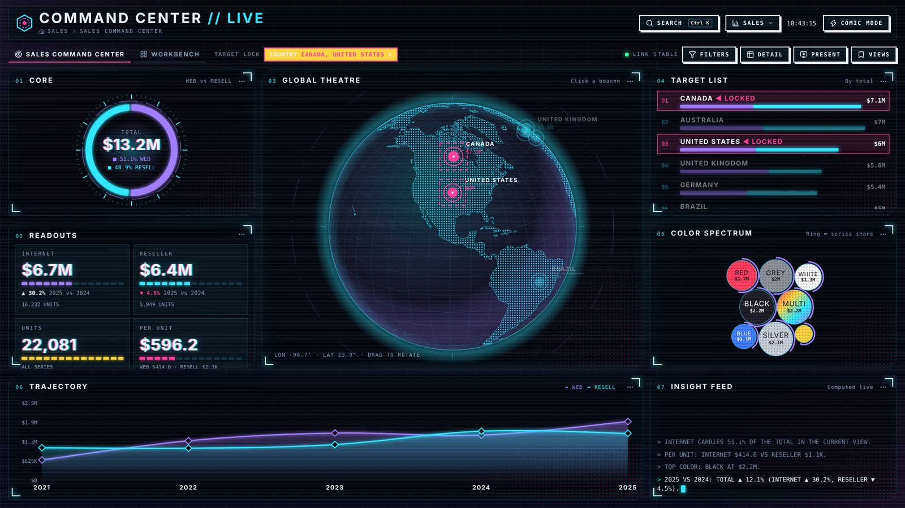
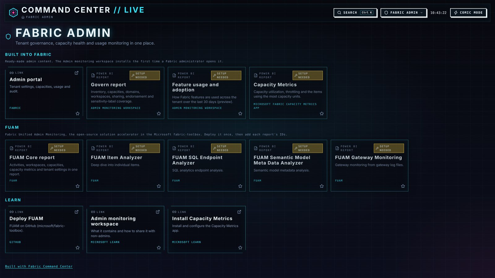
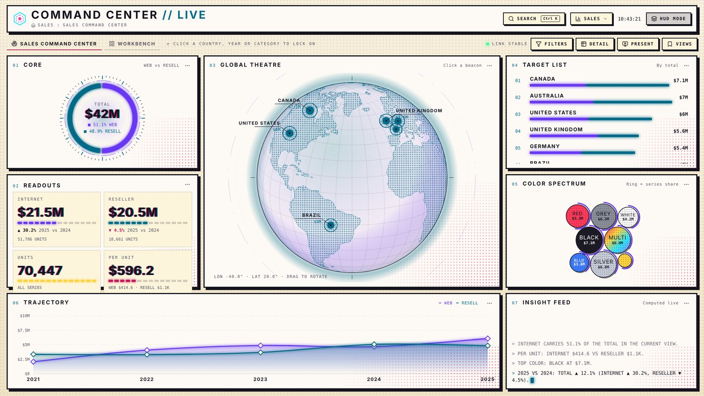
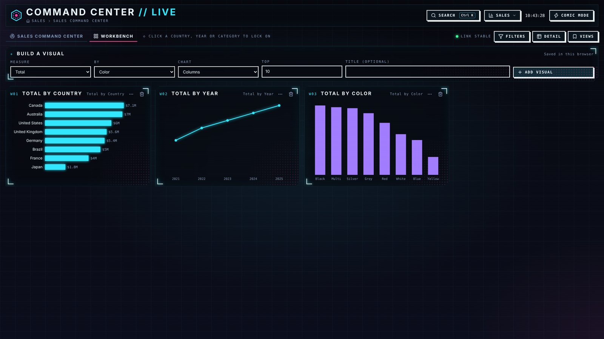
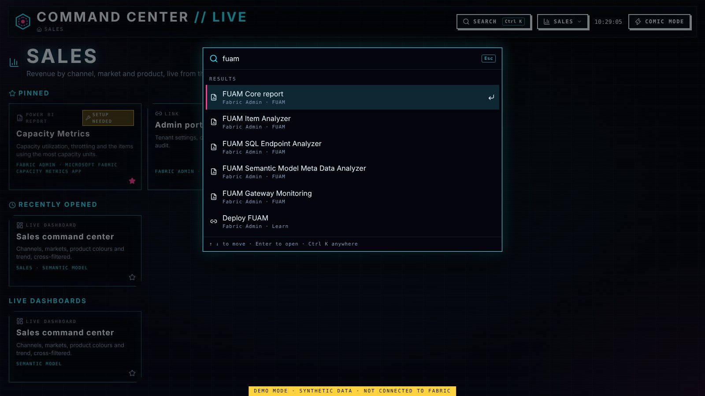
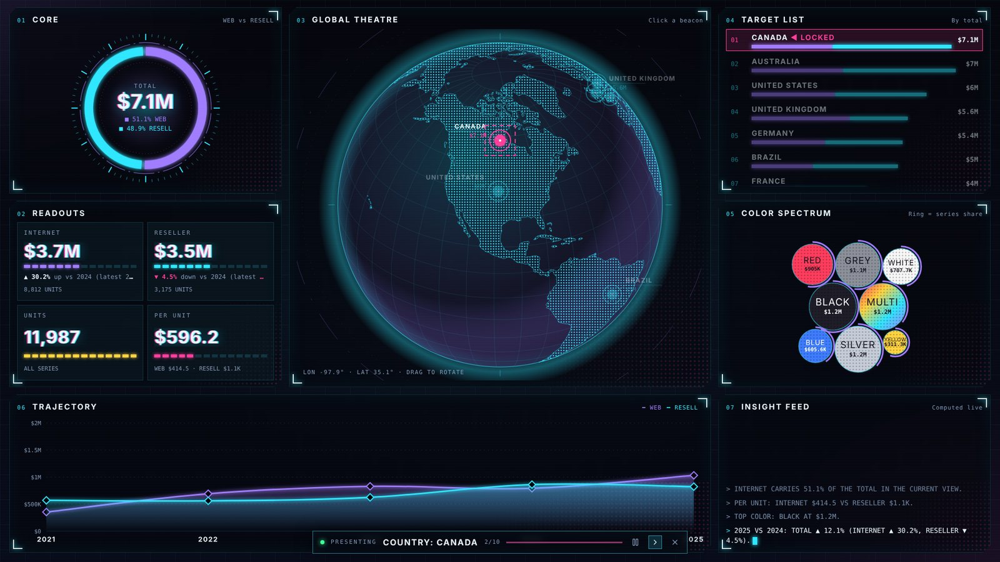
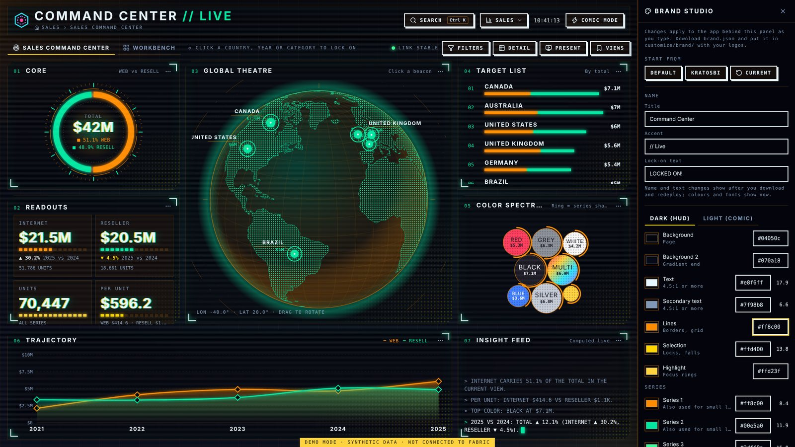

# Fabric Command Center

**One front door to your Microsoft Fabric content, live dashboards on your own semantic models, and your brand on top.**

Fabric Command Center is an open-source [Fabric App](https://learn.microsoft.com/fabric/) (built on the Rayfin SDK) that any company can deploy into its own Fabric tenant. People pick a profile such as Sales, Fabric Admin, Operations or HR, and land on a launchpad of the dashboards, Power BI reports and links that role needs. Dashboards query your semantic model live, cross-filter on every click, and look like nothing else in your tenant.

Everything a company changes lives in one folder, [`customize/`](customize). No code changes are needed to rebrand it, point it at a different model, or add a profile.



| Fabric Admin launchpad | Light "comic" look | Visual workbench |
| --- | --- | --- |
|  |  |  |

| Search everything (Ctrl+K) | Presentation mode | Brand Studio |
| --- | --- | --- |
|  |  |  |

Screenshots use the built-in demo mode, which runs on synthetic data.

## What you get

- **Profiles and launchpads.** Group content by role. A tile can be a live dashboard, a Power BI report or any link. The Fabric Admin profile comes pre-wired for the Admin monitoring workspace, the Capacity Metrics app and [FUAM](https://github.com/microsoft/fabric-toolbox/tree/main/monitoring/fabric-unified-admin-monitoring).
- **Live dashboards on your semantic model.** Every query is generated from a short JSON description of your model, so moving to a new company or model is a config change.
- **Cross-filtering everywhere.** Click any country, year or category to lock on. Ctrl or Shift + click adds to the selection. Each visual highlights its own selection instead of collapsing.
- **Filters pane and drill-through.** Multi-select slicers for every dimension, and a sortable detail table behind the current selection with CSV export.
- **Search everything with Ctrl+K.** Jump to any dashboard, report, link, saved view or profile from anywhere. Pin favourite tiles to the top of every launchpad; recently opened tiles follow you.
- **Saved and shareable views.** Name a filter state, reopen it later, or share it as a code. Where the Fabric portal supports deep links, the address bar becomes a shareable link and Back and Forward work.
- **Visual workbench.** Viewers build their own bar, column, line and table visuals from the model's measures and dimensions. They cross-filter like everything else.
- **Insight to action.** Every panel can export CSV or PNG, copy a summary, or share to Teams or email.
- **Period over period.** Readouts show the change against the previous year (or the period before the one you picked), and the insight feed calls it out per series.
- **Presentation mode.** One click runs a full-screen tour of the overview, top markets, top categories and latest period, for wall screens and demos.
- **Plain-English insights**, computed only from the numbers on screen.
- **Your brand.** Name, logos, colours, fonts and copy for both looks (dark HUD and light comic) from one file, plus switchable brand packs.
- **Optional embedded Power BI reports** with the app's filters applied (experimental, off by default).
- **A doctor** that checks your configuration and can run every generated query against your model before you deploy.
- **A demo mode** that runs the whole app on synthetic data with no Fabric account, plus a **Brand Studio** that restyles the live app as you pick colours and fonts and downloads the brand file.
- **`npm run setup`**: a guided setup that creates the brand, connects the model and proposes the model mapping from the model's own metadata.
- **Accessible and tested.** Keyboard operable throughout, WCAG 2.1 AA checks in both looks, and end-to-end browser tests on every change.

The feature set follows the scenarios in the [Power BI Embedded playground](https://playground.powerbi.com/) (capture report views, personalize visuals, insights to action, customize colours and mode), rebuilt as a Fabric App on your own data.

## Quick start

You need Node.js 22.13 or later, a Fabric workspace you can create items in, and Build permission on a semantic model.

```bash
git clone https://github.com/KratosDataGod/fabric-command-center.git
cd fabric-command-center
npm install
npm run demo          # try it on synthetic data at http://localhost:5173
```

Then connect it to your tenant. The quickest way is the guided setup:

```bash
npx rayfin login
npm run setup         # brand, model link, automatic model mapping, then a full check
```

Or step by step:

1. **Point it at your model.** Copy `rayfin/.env.example` to `rayfin/.env` and fill in the semantic model's workspace ID and item ID. Edit [`customize/models/sales.json`](customize/models/sales.json) so its measures and columns match your model (`npm run doctor -- --discover` lists them). See [Connect your model](docs/connect-your-model.md).
2. **Brand it.** Edit [`customize/brand/brand.json`](customize/brand/brand.json) and drop your logos into `customize/brand/`. See [Branding](docs/customize-branding.md).
3. **Set up profiles.** Edit the files in [`customize/profiles/`](customize/profiles). Report tiles say "Setup needed" until you add their IDs. See [Profiles](docs/profiles.md).
4. **Check it.** `npx rayfin login`, then `npm run doctor -- --live` runs every generated query against your model.
5. **Deploy.** `npx rayfin up --workspace "<workspace name>"` builds the app and deploys it to that workspace. See [Getting started](docs/getting-started.md).

## The `customize/` folder

```text
customize/
├── brand/              # the active brand: brand.json, logo.svg, mark.svg
├── brands/             # brand packs; switch with `npm run brand -- <pack>`
├── models/             # one JSON file per semantic model the dashboards use
├── profiles/           # one JSON file per profile (Sales, Admin, Ops, HR ...)
├── features.json       # turn modules, features and share actions on or off
├── powerbi.example.json# template for the optional report-embedding module
└── schema/             # JSON schemas: your editor validates and autocompletes
```

If something in `customize/` is wrong, the app shows the exact problems instead of a half-broken screen, and `npm run doctor` prints the same list.

## Commands

| Command | What it does |
| --- | --- |
| `npm run setup` | Guided setup: brand pack, model IDs, automatic model mapping, then the doctor |
| `npm run demo` | Run the app locally on synthetic data, no sign-in. Open the Brand Studio from the button at the bottom left |
| `npm run dev` | Run the app locally against your real model (needs `npx rayfin login`) |
| `npm run doctor` | Check `customize/`, connectors and brand files. Add `-- --live` to test every query, or `-- --discover` to list your model's tables and measures |
| `npm run brand -- <pack>` | Make a brand pack from `customize/brands/` the active brand |
| `npm run check` | Typecheck, lint, test and doctor in one go |
| `npm run test:e2e` | End-to-end and accessibility tests in a real browser, on the demo build |
| `npx rayfin up --workspace "<name>"` | Build and deploy to a Fabric workspace |

## Documentation

- [Getting started](docs/getting-started.md): from clone to deployed app
- [Connect your model](docs/connect-your-model.md): describe your semantic model in `models/*.json`
- [Branding](docs/customize-branding.md): name, logos, colours, fonts, copy and brand packs
- [Profiles](docs/profiles.md): launchpads, tiles and the pre-wired Admin profile
- [Features](docs/features.md): every module, feature and action, and how to turn it off
- [Power BI embedding](docs/power-bi-embed.md): the optional report module
- [Rollout playbook](docs/rollout-playbook.md): taking it to many companies or business units
- [Architecture](docs/architecture.md): how the pieces fit together

## Security and data

- The app runs inside Fabric with the viewer's own identity. Every query runs with their permissions on the semantic model, so row-level security applies.
- **Profiles control what is shown, not what people can access.** Fabric permissions still decide who can open each report or model.
- Nothing tenant-specific is committed: model IDs live in `rayfin/.env` and embedding settings in `customize/powerbi.local.json`, both git-ignored.
- Saved views and workbench visuals are stored in the viewer's browser only.

See [SECURITY.md](SECURITY.md) to report a vulnerability.

## Status

Fabric Apps and the Rayfin SDK are in preview, and so is this project. The optional Power BI embedding module has not yet been tested end to end in a tenant. Issues and pull requests are welcome: see [CONTRIBUTING.md](CONTRIBUTING.md).

## License

MIT. See [LICENSE](LICENSE). Built on the Microsoft Rayfin app template, which is also MIT licensed.
